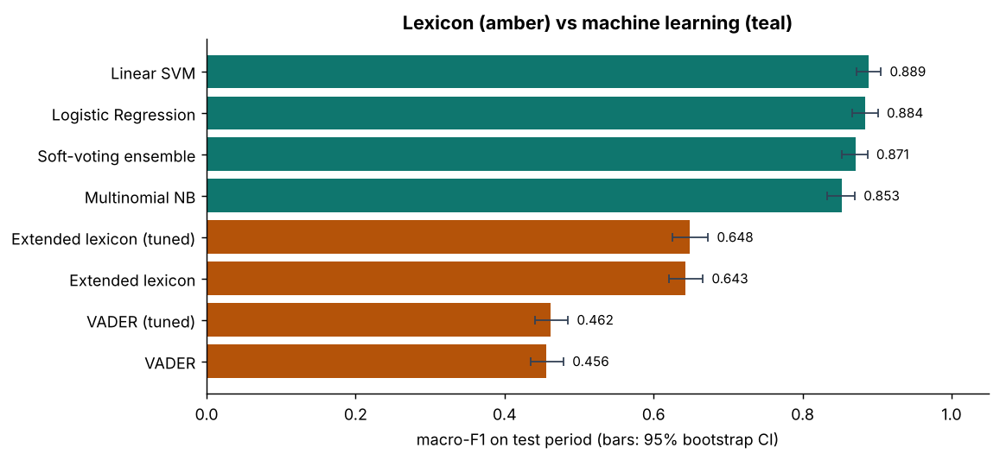
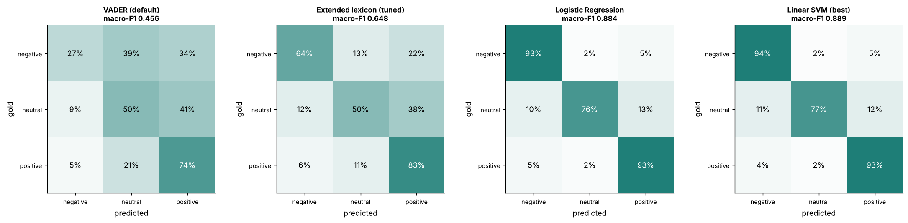
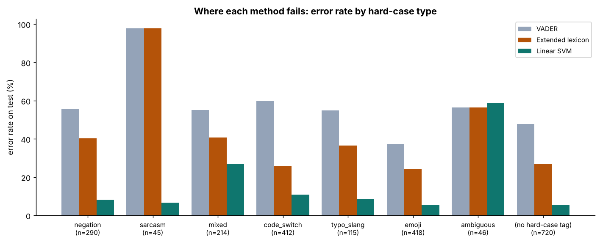
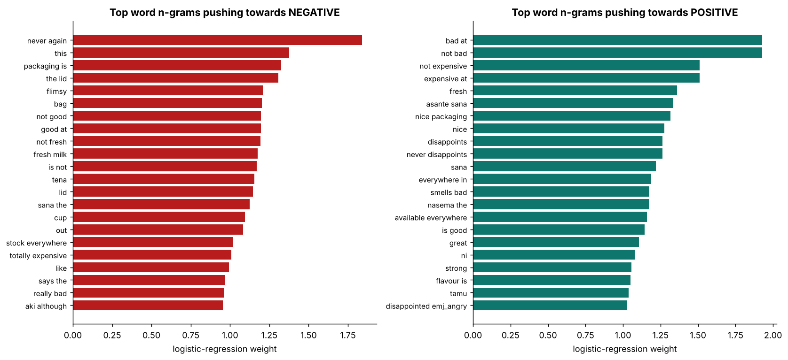
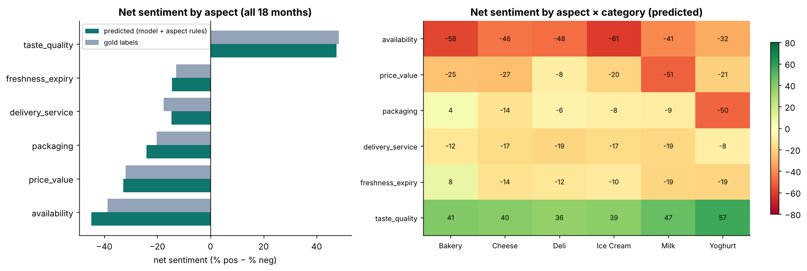
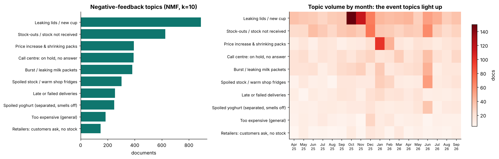
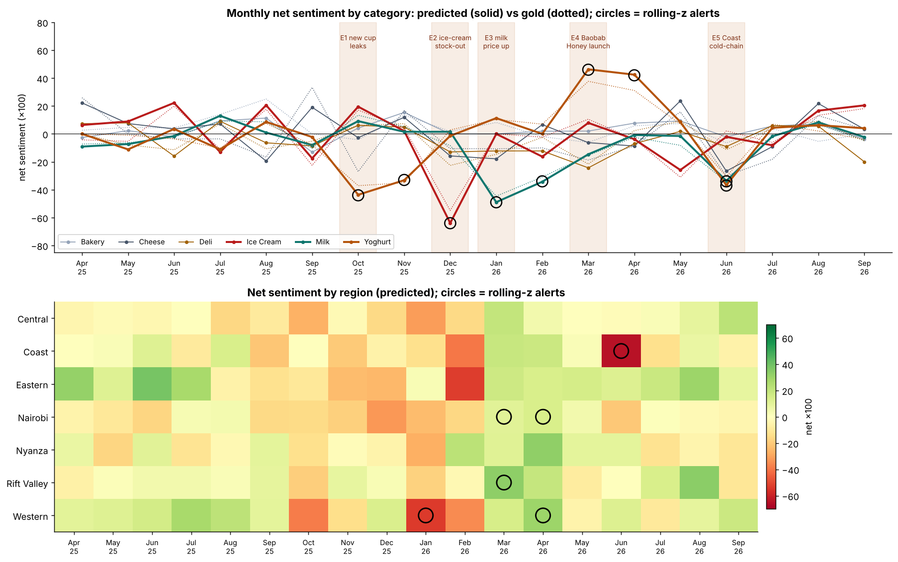

# Customer Feedback Sentiment Analysis — what are customers telling us, and who should act on it?

Sentiment analysis of **8,298 customer feedback messages** over 18 months for **"Maziwa Bora"**, a *fictional* Kenyan dairy brand (milk, yoghurt, cheese, ice cream, bakery, deli). The messages come from five channels: product reviews, X/Twitter posts, Facebook comments, WhatsApp / call-centre tickets and retailer / merchandiser comments. They are written in English, Kiswahili and Sheng, often in the same sentence.

1. **Three ways to score sentiment:** an off-the-shelf lexicon (VADER), VADER extended with a hand-built **Kiswahili/Sheng and dairy lexicon**, and **TF-IDF machine-learning models** (Logistic Regression, Linear SVM, Naive Bayes, ensemble).
2. **Aspect-based sentiment:** *what* customers are positive or negative about (taste, freshness, price, packaging, availability, delivery).
3. **Topic discovery** on negative feedback (NMF), and **trend monitoring** with a rolling z-score that **detected all five hidden business events** and turns them into routed alerts.

> **Data note:** all data is **synthetic**, generated by [`data/generate_data.py`](data/generate_data.py) from a large set of templates and phrase banks. The brand and products are fictional; no real company, brand, retailer or customer appears. The generator deliberately includes hard cases (negation, sarcasm, mixed sentiment, code-switching, typos, emojis), **flips about 5% of the gold labels** to mimic annotator noise, and hides five business events in the timeline.

| | |
|---|---|
| 📓 **Full walkthrough, every step explained** | [`python/sentiment_analysis.ipynb`](python/sentiment_analysis.ipynb) |
| 🧰 **Hand-built cleaning, Swahili/Sheng dictionary, lexicon, aspect rules** | [`python/text_utils.py`](python/text_utils.py) |
| 🚨 **Routed alert file** | [`outputs/alerts.csv`](outputs/alerts.csv) |

---

## 1. Why do this analysis?

| Question | What sentiment analysis gives you |
|---|---|
| **Are customers happier or angrier than last month?** | A **net sentiment score** by product, region and channel, tracked like any KPI |
| **What exactly are they unhappy about?** | **Aspect-based sentiment:** "negative about *packaging*, on *yoghurt*, since *October*" is actionable; "negative" is not |
| **Is something going wrong right now?** | **Early warning:** a cold-chain failure shows up in WhatsApp complaints before it shows up in returns data |
| **Did our launch or price change land well?** | Measured customer reaction instead of a guess |
| **Who should act?** | Alerts routed to QA, supply chain, pricing, packaging or customer service |

---

## 2. Method

```
feedback text (5 channels, English / Kiswahili / Sheng)
   └─► cleaning: brand masking · emoji → tokens · slang · Swahili/Sheng normalisation (phrases first: "tamu mbaya" = extremely tasty)
         ├─► METHOD 1  Lexicon:  VADER (compound score, ±0.05)  vs  VADER + 52 dairy words + Kiswahili/Sheng translation
         ├─► METHOD 2  ML:       TF-IDF word 1-2-grams + char 2-5-grams → LogReg · Linear SVM · Multinomial NB
         │                      time-based split (train Apr 2025–May 2026, test Jun–Sep 2026) · 5-fold CV tuning on macro-F1
         ├─► METHOD 3  Soft-voting ensemble
         │   evaluation: accuracy · macro-F1 + bootstrap CI · per-class P/R · confusion matrices · error rate by hard-case type
         ├─► Aspect-based sentiment: clause splitting → keyword/regex aspects (EN + SW) → clause sentiment → net score per aspect
         ├─► Topic discovery: NMF on negative feedback (boilerplate and product names removed)
         └─► Trend monitoring: monthly net sentiment × category / region → rolling z-score (sampling-based SE) → alerts.csv
```

---

## 3. Results: lexicon vs machine learning

Held-out test period: **June – September 2026, 1,829 items** that no model saw during training or tuning.

| Method | Accuracy | **Macro-F1** | 95% CI | Negative recall | Neutral F1 |
|---|---:|---:|---|---:|---:|
| VADER (default ±0.05) | 0.492 | 0.456 | 0.435–0.479 | 0.28 | 0.31 |
| VADER (thresholds tuned on train) | 0.495 | 0.462 | 0.441–0.485 | 0.28 | 0.33 |
| **VADER + Kenyan dairy lexicon** (tuned) | 0.695 | **0.648** | 0.625–0.673 | 0.64 | 0.46 |
| Multinomial Naive Bayes | 0.873 | 0.853 | 0.833–0.870 | 0.90 | — |
| Soft-voting ensemble | 0.891 | 0.871 | 0.853–0.887 | 0.92 | — |
| Logistic Regression | 0.905 | 0.884 | 0.867–0.901 | 0.93 | — |
| **Linear SVM (best)** | **0.909** | **0.889** | 0.873–0.905 | 0.94 | 0.82 |



- **Off-the-shelf VADER fails on this data.** It knows no Kiswahili or Sheng and not even *expired* or *leaking*: **a third of test items score exactly 0**, so most complaints come out *neutral*.
- **The domain lexicon adds +0.19 macro-F1** (0.456 → 0.648). It fixed 405 test items and broke 35. Tuning the thresholds adds almost nothing; the problem was vocabulary.
- **Machine learning adds another +0.24.** Linear SVM and Logistic Regression are statistically tied. **The ensemble did not help** (0.871): the models make correlated errors and Naive Bayes drags the average down.
- **An honest ablation:** Swahili/Sheng normalisation is essential for the lexicon but adds **nothing measurable for the ML model** (CV 0.874 → 0.875), because a supervised model learns *imeharibika* = negative from the labels. Bigrams are how the model learns negation (CV F1 on negation items 0.821 → 0.834).
- About 5% of gold labels are deliberately wrong, so **about 95% accuracy is the realistic ceiling**.



### Where each method fails (test error rate, %)

| Hard case | Items | VADER | Extended lexicon | Linear SVM |
|---|---:|---:|---:|---:|
| Negation ("not bad at all", "not fresh") | 290 | 55.5 | 40.3 | 8.3 |
| Sarcasm ("Great, another expired yoghurt 🙄") | 45 | **97.8** | **97.8** | 6.7* |
| Mixed ("love the taste but too expensive") | 214 | 55.1 | 40.7 | **27.1** |
| Kiswahili / Sheng code-switching | 412 | 59.7 | 25.7 | 10.9 |
| Typos / slang | 115 | 54.8 | 36.5 | 8.7 |
| Ambiguous ("ok", "hmm 🤔") | 46 | 56.5 | 56.5 | 58.7 |
| No hard-case tag | 720 | 47.9 | 26.8 | 5.4 |
| **All** | 1,829 | 50.8 | 30.5 | **9.1** |



- **Mixed sentiment is the ML model's weak spot:** five times the error rate of plain text. A bag of n-grams cannot tell which clause is the main one.
- **\*Sarcasm:** the lexicons are fooled every time. The ML model's 3 errors are all items whose gold label is itself wrong, **but** the generator has only a few sarcasm templates, which the model can memorise. On real data, expect sarcasm to be one of the biggest error sources.

**Explainability:** the strongest Logistic Regression features confirm the model learned negation (`not bad`, `not expensive` → positive; `not fresh`, `not good` → negative) and dairy issues (`the lid`, `flimsy`, `stock everywhere`, `inavuja`). They also expose **shortcut learning**: `says the` (from retailer comments, which are mostly complaints) and the product name `fresh milk` push towards negative.



---

## 4. Aspect-based sentiment: customers love the product, not the operation

| Aspect | Detection F1 | Mentions | % negative | **Net sentiment** (predicted) | Net (gold) |
|---|---:|---:|---:|---:|---:|
| Taste / quality | 0.885 | 2,060 | 22.3 | **+47.5** | +48.4 |
| Freshness / expiry | 0.988 | 1,920 | 53.7 | −14.5 | −12.9 |
| Delivery / service | 0.907 | 1,723 | 49.4 | −14.6 | −17.7 |
| Packaging | 0.920 | 1,622 | 56.0 | −24.1 | −20.2 |
| Price / value | 0.979 | 1,481 | 61.0 | −32.8 | −31.9 |
| **Availability / stock-outs** | 0.981 | 1,211 | 66.8 | **−44.8** | −38.8 |



- **Clause sentiment needs ML.** Applying the Linear SVM to each clause gets the aspect polarity right **97.5%** of the time, against 77.3% for the extended lexicon. The lexicon misses complaints with no sentiment words, such as "customers keep asking and we have none".
- **Hotspots:** packaging is a **yoghurt** problem (−50, the new cup), price is a **milk** problem (−51), and availability is worst for **ice cream** (−61). **Taste is positive in every category**, highest for yoghurt (+57).
- *Caveat:* the aspect keyword rules were written knowing the generator's vocabulary, so detection scores are an upper bound.

### Top negative topics (NMF, k = 10)

| Topic | Docs | Peak |
|---|---:|---|
| Leaking lids / new cup | 889 | Oct 2025 |
| Stock-outs / stock not received | 625 | Dec 2025 |
| Price increase & shrinking packs | 393 | Jan 2026 |
| Call centre: on hold, no answer | 392 | Jun 2026 |
| Burst / leaking milk packets | 382 | Jun 2026 |
| Spoiled stock / warm shop fridges | 302 | Jun 2026 |
| Late or failed deliveries · Spoiled yoghurt · Too expensive · Retailers: no stock | 147–255 | — |



Channel boilerplate ("Hello customer care", "Please sort this out") and product names were removed first. Without that step the topics were just greetings.

---

## 5. Trend monitoring: all five hidden events detected

Monthly net sentiment (on **model-predicted** labels, as in production) by category, region and category × region. An alert fires when **|z| ≥ 3.5** against the median of the previous six months, using the sampling standard error, **and** the shift is at least 0.20 **and** n ≥ 20.

| Embedded event | First alert | Strongest \|z\| | Driver aspect found |
|---|---|---:|---|
| E1 New yoghurt cup leaks (Oct–Nov 2025) | Oct 2025 | 7.6 | packaging |
| E2 Festive ice-cream stock-out, Nairobi (Dec 2025) | Dec 2025 | 9.9 | availability |
| E3 Milk price increase (Jan–Feb 2026) | Jan 2026 | 9.1 | price / value |
| E4 Baobab Honey yoghurt launch (Mar–Apr 2026, positive) | Mar 2026 | 8.5 | taste / quality |
| E5 Coast cold-chain / expiry incident (Jun 2026) | Jun 2026 | 9.6 | freshness / expiry |



- **5 of 5 events detected, each in its first month. 26 of 27 alerts belong to an event.** The one exception is a low-severity Nairobi rebound in April 2026, which an analyst would close quickly.
- The same scan on **gold** labels finds all five events too (20 alerts, 19 shared), so the model's predictions are good enough to run the monitor.
- **Drill-down matters:** the ice-cream stock-out is z = −9.6 for *Ice Cream × Nairobi* but diluted in Nairobi's total. **Small segments are a blind spot:** Eastern's February dip had only 17 items, below the volume threshold.

Each alert in [`outputs/alerts.csv`](outputs/alerts.csv) carries a severity, driver aspect, **owner**, suggested action and three example messages.

---

## 6. Recommended actions

| Finding | Owner | Action |
|---|---|---|
| New yoghurt cup leaks (largest complaint topic) | Packaging engineering & Procurement | Seal-integrity tests, supplier escalation; consumer-test future pack changes and watch sentiment for 4 weeks after launch |
| Festive stock-outs; availability is the most negative aspect | Supply planning & Sales ops | Festive uplift in the forecast, pre-positioned stock, distributor fill-rate KPIs |
| Milk price increase (strongest reaction in Western) | Commercial / Pricing | Explain the increase, protect an affordable entry pack, targeted value promotions |
| Coast cold-chain incident | Cold-chain & QA, Customer service | Outlet fridge audits, batch trace, temperature loggers, replacement script |
| Baobab Honey launch success | Marketing & Supply planning | Amplify reviews, secure stock, consider line extensions |
| Call centre "on hold" complaints peak during incidents | Customer service | Surge staffing, WhatsApp self-service, callback SLA |
| Taste is the brand's strength (+48) | Marketing / R&D | Protect the recipe; lead with quality |

**Production note:** the next step would be to fine-tune a multilingual transformer (multilingual BERT, or an AfroXLMR-style model pre-trained on African languages including Kiswahili) and compare it with these baselines. **It could not be evaluated here**, because model downloads are blocked in this environment. The TF-IDF models are the benchmark such a model would have to beat by enough to justify its cost.

---

## 7. Where sentiment analysis is used

| Industry | Application |
|---|---|
| FMCG / food & beverage | Quality early warning, launch tracking, packaging and retailer feedback |
| Retail & e-commerce | Review mining, return reasons |
| Banking, micro-finance & mobile money | App reviews, complaint triage, regulatory complaint monitoring |
| Telecoms | Network and service complaints by region, churn signals from care transcripts |
| Hospitality & travel | Aspect-based review analysis (room, staff, food, location) |
| Healthcare & NGOs | Patient experience, community feedback on programmes |
| Public sector | Citizen feedback, policy reaction on social media |
| HR | Engagement-survey free text, exit-interview themes |

---

## 8. Limitations

- **Synthetic, template-based text:** the scores are optimistic compared with real feedback, especially for sarcasm and aspect detection.
- **Sarcasm and mixed sentiment** remain the hardest cases. Fixing them needs context-aware models.
- **Kiswahili/Sheng changes quickly** and varies by city, so the normalisation dictionary needs regular updates.
- **Label quality:** about 5% noisy labels. Real 3-class sentiment typically has 80–90% inter-annotator agreement, and mixed items need a written labelling rule.
- **Selection bias and channel mix:** people who post are not a random sample of customers. Read sentiment alongside sales and returns.
- **Monthly granularity:** production monitoring should run weekly or daily with the same statistical rule.

---

## 9. Run it

```bash
pip install -r requirements.txt
python data/generate_data.py                       # optional: regenerate data (seeded, deterministic)
python python/build_notebook.py
jupyter nbconvert --to notebook --execute --inplace python/sentiment_analysis.ipynb   # ~3 minutes on 2 CPUs
```

```
sentiment-analysis/
├── data/      generate_data.py · feedback.csv (8,298 items, gold sentiment + 6 aspect labels + hard-case tags)
├── python/    text_utils.py (cleaning, Swahili/Sheng dictionary, lexicon, aspect rules) · build_notebook.py · sentiment_analysis.ipynb
└── outputs/   9 charts · model_comparison.csv · hard_case_error_rates.csv · aspect_*.csv · negative_topics_nmf.csv
               monthly_sentiment.csv · alerts.csv · scored_feedback.csv · sentiment_model.joblib (0.3 MB, LogReg)
```

**Stack:** Python · pandas · scikit-learn · vaderSentiment · matplotlib · NumPy (no NLTK/spaCy downloads: tokenisation, stop-words and normalisation are hand-built)
